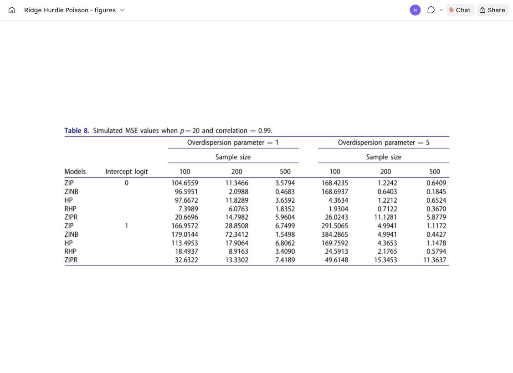
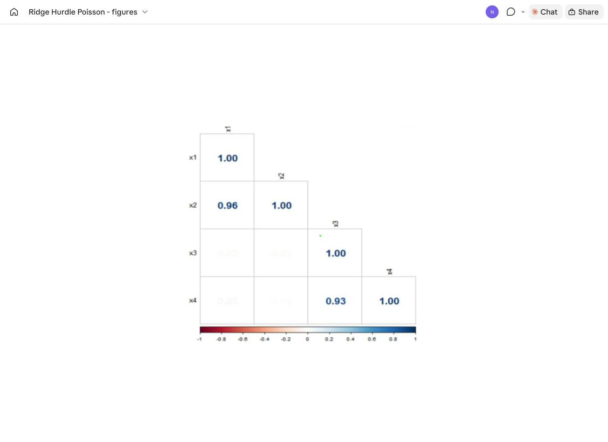

# Ridge-Hurdle Poisson (RHP) Model for Zero-Inflated Count Data with Multicollinearity

[](https://doi.org/10.1080/03610918.2025.2610985)


R code and data for the paper:

> **Nayem, H. M., & Kibria, B. M. G. (2026).** A novel Ridge-Hurdle Poisson model for addressing multicollinearity in zero-inflated count data. *Communications in Statistics – Simulation and Computation*. https://doi.org/10.1080/03610918.2025.2610985

---

## Summary

Count outcomes in health, transport, manufacturing and the social sciences often have **too many zeros**, **overdispersion** and **highly correlated predictors**, all at once. Zero-inflated and hurdle models deal with the excess zeros, but their maximum-likelihood estimates become unstable when the covariates are multicollinear.

This paper proposes the **Ridge-Hurdle Poisson (RHP)** model. It keeps the two-part hurdle structure:

1. a **binary (logit) part** for zero vs. positive counts, and
2. a **zero-truncated Poisson part** for the positive counts,

and adds an **L2 (ridge) penalty** to the count-part likelihood. The penalty shrinks the coefficients towards zero, reduces their variance and stabilises the estimates under severe multicollinearity. The tuning parameter λ is chosen by 5-fold cross-validation.

RHP is compared with four competitors:

| Abbreviation | Model |
|---|---|
| ZIP | Zero-inflated Poisson |
| ZINB | Zero-inflated negative binomial |
| HP | Hurdle Poisson |
| ZIPR | Ridge zero-inflated Poisson |
| **RHP** | **Ridge-Hurdle Poisson (proposed)** |

**Main finding:** RHP gives the lowest MSE in almost every simulation setting and in both real-data examples. Its advantage is largest when samples are small, correlation is high and there are many predictors.

---

## Simulation design

| Factor | Levels |
|---|---|
| Sample size *n* | 100, 200, 500 |
| Number of predictors *p* | 10, 20 |
| Correlation ρ | 0.80, 0.90, 0.95, 0.99 |
| Zero-inflation intercept *c*₀ (π = plogis(*c*₀)) | 0 (50% structural zeros), 1 (≈ 73%) |
| Overdispersion θ (NB size) | 1, 5 |
| Replications | 5000 (paper) |

- Predictors: *x*ᵢⱼ = √(1 − ρ²) *a*ᵢⱼ + ρ *a*ᵢ,ₚ₊₁ with *a* ~ N(0, 1), then standardised.
- Response: with probability π, *Y* = 0; otherwise *Y* ~ NB(μ = exp(*X*β), θ). The data therefore include zero inflation and overdispersion.
- True β: the normalised eigenvector for the largest eigenvalue of *X′X* (Newhouse & Oman 1971).
- Criterion: MSE(β̂) = mean of (β̂ − β)² over the replications.

### Example result (Table 8: *p* = 20, ρ = 0.99)



Selected numbers from the paper:

- *p* = 10, ρ = 0.80, *c*₀ = 0, θ = 1, *n* = 100: RHP **0.0729**, ZIP 0.5547, ZINB 0.4486.
- *p* = 20, ρ = 0.99, *c*₀ = 0, θ = 1, *n* = 100: RHP **7.3989**, ZIP 104.6559.
- *p* = 20, ρ = 0.99, *c*₀ = 1, *n* = 100 / 200 / 500: RHP **18.49 / 8.92 / 3.41**, ZIP 166.96 / 28.85 / 6.75.

---

## Real-data applications

### 1. Plastic Plywood data (`data/plastic_plywood.csv`)

| Variable | Description |
|---|---|
| `y` | Number of defects in each area of laminated plastic plywood (count) |
| `x1` | Volumetric shrinkage |
| `x2` | Assembly time |
| `x3` | Wood density |
| `x4` | Drying temperature |

- 100 observations and 4 predictors.
- Overdispersed: estimated dispersion φ̂ = 2.416, index of dispersion D = σ²/μ = 135.614.
- Severe multicollinearity: condition index CI = 8634.73.
- Used before by Marcondes Filho & Sant'Anna (2016), Sami et al. (2022) and Ashraf et al. (2025).



**Table 9 – MSE, Plastic Plywood data**

| Method | MSE |
|---|---|
| ZIP | 0.5730 |
| ZINB | 0.5730 |
| HP | 0.2284 |
| ZIPR | 0.1007 |
| **RHP** | **0.0901** |

### 2. bioChemists data (R package `pscl`)

915 biochemistry PhD students (Long 1990).

| Variable | Description |
|---|---|
| `art` | Articles published in the last 3 years of the PhD (count response) |
| `fem` | Gender (Men / Women) |
| `mar` | Marital status (Single / Married) |
| `kid5` | Number of children aged 5 or younger |
| `phd` | Prestige of the PhD department |
| `ment` | Articles by the mentor in the same 3 years |

- Zero inflation: 275 zeros observed vs. 191 expected under a Poisson model.
- Dispersion is 2.19 and the condition number is 49.87 (moderate multicollinearity).

**Table 10 – MSE, bioChemists data**

| Method | MSE |
|---|---|
| ZIP | 0.11589 |
| ZINB | 0.08542 |
| HP | 0.05253 |
| ZIPR | 0.06419 |
| **RHP** | **0.04999** |

---

## Repository structure

```
Ridge-Hurdle-Poisson/
├── R/
│   ├── simulation_study.R               # Main Monte Carlo study (ZIP, ZINB, HP, RHP, ZIPR)
│   ├── application_plastic_plywood.R    # Real data 1: Plastic Plywood (Table 9, Figure 1)
│   ├── application_biochemists.R        # Real data 2: bioChemists (Table 10)
│   └── extra/                           # Exploratory / earlier versions (not in the paper)
│       ├── simulation_with_ridge_zinb.R     # Main study + Ridge ZINB
│       ├── simulation_glmnet_ridge_zip.R    # ZIP-generated data, glmnet RHP, penalised-likelihood ridge ZIP
│       ├── simulation_bayesian_brms.R       # Bayesian ridge-prior hurdle / ZI models (brms + cmdstanr)
│       ├── simulation_nb_lindley_stan.R     # NB-Lindley latent model (rstan) + glmnet Ridge/Lasso/EN
│       ├── application_apprentice.R         # Apprentice data (33 obs., not in the paper)
│       └── application_doctorvisits.R       # AER DoctorVisits data
├── data/
│   ├── plastic_plywood.csv              # 100 x 5 (y, x1–x4)
│   └── apprentice.csv                   # 33 x 5 (y, x1–x4), used by the extra script
├── docs/
│   ├── fig1_correlation_plastic_plywood.png
│   └── table8_mse_p20_rho0.99.png
└── README.md
```

---

## How to run

1. Install R (≥ 4.2) and the packages you need:

```r
install.packages(c("MASS", "pscl", "glmnet", "openxlsx", "dplyr", "corrplot", "AER"))
# only for the Bayesian / Stan scripts in R/extra:
install.packages(c("brms", "rstan"))
# cmdstanr: https://mc-stan.org/cmdstanr/
```

2. The scripts read and write files with **absolute Windows paths** from the authors' machine. Before you run them, change the `read.csv(...)` and `write.xlsx(...)` paths, for example:

```r
data <- read.csv("data/plastic_plywood.csv")
write.xlsx(results, "results_simulation.xlsx")
```

3. Load `corrplot` before the correlation plots (`library(corrplot)`).
4. `R/simulation_study.R` uses `nsim <- 10` for a quick run. Increase `nsim` to reproduce the paper's 5000 replications; this takes much longer.

---

## Citation

```bibtex
@article{nayem2026ridgehurdle,
  title   = {A novel Ridge-Hurdle Poisson model for addressing multicollinearity in zero-inflated count data},
  author  = {Nayem, H. M. and Kibria, B. M. Golam},
  journal = {Communications in Statistics - Simulation and Computation},
  year    = {2026},
  doi     = {10.1080/03610918.2025.2610985}
}
```

---

## References

Abonazel MR, El-Sayed SM, Saber OM. 2021. Performance of robust count regression estimators in the case of overdispersion, zero inflated, and outliers: simulation study and application to German health data. Commun Math Biol Neurosci. Article-ID 55, 2021. https://scik.org/index.php/cmbn/article/view/5658

Akram MN, Abonazel MR, Amin M, Kibria BG, Afzal N. 2022. A new Stein estimator for the zero-inflated negative binomial regression model. Concurr Comput. 34(19):e7045. https://doi.org/10.1002/cpe.7045

Akram MN, Afzal N, Amin M, Batool A. 2024. Modified ridge-type estimator for the zero inflated negative binomial regression model. Commun Stat Simul Comput. 53(11):5305–5322. https://doi.org/10.1080/03610918.2023. 2179070

Akram MN, Amin M, Afzal N, Kibria BG. 2025. Kibria–Lukman estimator for the zero inflated negative binomial regression model: theory, simulation and applications. Commun Stat Simul Comput. 54(5):1464–1480. https://doi.org/10.1080/03610918.2023.2286436

Aladeitan BB, Adebimpe O, Lukman AF, Oludoun O, Abiodun OE. 2021. Modified Kibria-Lukman (MKL) estimator for the Poisson Regression Model: application and simulation. F1000Res. 10:548. https://doi.org/10.12688/ f1000research.53987.2

Alghamdi FM et al. 2025. On robust and non-robust modified Liu estimation in Poisson regression model with multicollinearity and outliers. Int J Unc Fuzz Knowl Based Syst. 33(06):787–823. https://doi.org/10.1142/ S0218488525500266

Alheety MI, Nayem HM, Kibria BG. 2025. An unbiased convex estimator depending on prior information for the classical linear regression model. Stats (Basel). 8(1):16. https://doi.org/10.3390/stats8010016

Almulhim FA et al. 2025. New two parameter hybrid estimator for zero inflated negative binomial regression models. Sci Rep. 15(1):21239. https://doi.org/10.1038/s41598-025-06116-4

Altinisik Y. 2023. Addressing overdispersion and zero-inflation for clustered count data via new multilevel heterogenous hurdle models. J Appl Stat. 50(2):408–433. https://doi.org/10.1080/02664763.2022.2096875

Al-Taweel Y, Algamal Z. 2022. Almost unbiased ridge estimator in the zero-inflated Poisson regression model. TWMS J Appl Eng Math., 12(1):235–246.

Asar Y. 2018. Liu-type negative binomial regression: a comparison of recent estimators and applications. In: Trends and perspectives in linear statistical inference: proceedings of the LINSTAT2016 meeting held 22–25 August 2016 in Istanbul, Turkey. Springer International Publishing. p 23–39. https://doi.org/10.1007/978-3-319-73241-1_2

Ashraf B, Amin M, Emam W, Tashkandy Y, Faisal M. 2025. Negative binomial regression model estimation using stein approach: methods, simulation, and applications. J Math. 2025(1):9134821. https://doi.org/10.1155/jom/ 9134821

Bertoli W, Conceição KS, Andrade MG, Louzada F. 2020. A Bayesian approach for some zero-modified Poisson mixture models. Stat Model. 20(5):467–501. https://doi.org/10.1177/1471082X19841984

Cameron AC, Trivedi PK. 1998. Regression analysis of count data. Cambridge Univ. Press, New York, NY.

Cameron AC, Trivedi PK. 2013. Regression analysis of count data. 2nd ed. Cambridge University Press.

Deb P, Trivedi PK. 1997. Demand for medical care by the elderly: a finite mixture approach. J Appl Econ. 12(3): 313–336. https://doi.org/10.1002/(SICI)1099-1255(199705)12:3<313::AID-JAE440>3.0.CO;2-G

Dormann CF et al. 2013. Collinearity: a review of methods to deal with it and a simulation study evaluating their performance. Ecography. 36(1):27–46. https://doi.org/10.1111/j.1600-0587.2012.07348.x

Fletcher D, MacKenzie D, Villouta E. 2005. Modelling skewed data with many zeros: a simple approach combining ordinary and logistic regression. Environ Ecol Stat. 12(1):45–54. https://doi.org/10.1007/s10651-005-6817-1

Friedman J, Hastie T, Tibshirani R. 2010. Regularization paths for generalized linear models via coordinate descent. J Stat Softw. 33(1):1–22. https://doi.org/10.18637/jss.v033.i01

Greene WH. 1994. Accounting for excess zeros and sample selection in Poisson and negative binomial regression models. NYU Working Paper.

Hoerl AE, Kennard RW. 1970. Ridge regression: biased estimation for nonorthogonal problems. Technometrics. 12(1):55–67. https://doi.org/10.1080/00401706.1970.10488634 19

Hoque MA, Kibria BG. 2024. Performance of some estimators for the multicollinear logistic regression model: theory, simulation, and applications. Res Stat. 2(1):2364747. https://doi.org/10.1080/27684520.2024.2364747

Hoque MA, Kibria BM. 2023. Some one and two parameter estimators for the multicollinear gaussian linear regression model: simulations and applications. Surv Math Its Appl. 18:183–221.

Hua HE, Wan TANG, Wenjuan WANG, Paul CC. 2014. Structural zeroes and zero-inflated models. Shanghai Arch Psychiatry. 26(4):236.

Karim MR, Yamamoto T, Shankar VN. 2020. Modeling traffic crash injury severity with zero-inflated models. Accid Anal Prev. 134:105351.

Khan A, Ullah MA, Amin M. 2023. Poisson regression diagnostics with ridge estimation. Commun Stat Simul Comput. 52(9):4174–4192. https://doi.org/10.1080/03610918.2021.1955262

Kharrat T, Zghal M, Boubaker H. 2022. Regularized count data models: a comparative study. Commun Stat Simul Comput. 51(5):1552–1570.

Kibria BG. 2003. Performance of some new ridge regression estimators. Commun Stat Simul Comput. 32(2):419–435. https://doi.org/10.1081/SAC-120017499

Kibria BG, Månsson K, Shukur G. 2011. A ridge regression estimator for the zero-inflated Poisson model. Royal Institute of Technology, CESIS-Centre of Excellence for Science and Innovation Studies.

Kibria BG, Månsson K, Shukur G. 2013. Some ridge regression estimators for the zero-inflated Poisson model. Appl Stat. 40(4):721–735. https://doi.org/10.1080/02664763.2012.752448

Kibria BG, Månsson K, Shukur G. 2015. A simulation study of some biasing parameters for the ridge type estimation of Poisson regression. Commun Stat Simul Comput. 44(4):943–957. https://doi.org/10.1080/03610918.2013. 796981

Kibria BM et al. 2025. Enhancing a robust Poisson regression estimator for multicollinear and outliered data: simulation and application. AIP Adv. 15(9). https://doi.org/10.1063/5.0290412

Kim M, Lee K, Song M. 2021. Penalized zero-inflated count regression with variable selection. Stat Papers. 62(1): 159–186.

Kwon D, Hwang H. 2022. Regularized zero-inflated models for high-dimensional count data. J Stat Comput Simul. 92(14):2983–2999.

Lambert D. 1992. Zero-inflated Poisson regression, with an application to defects in manufacturing. Technometrics. 34(1):1–14. https://doi.org/10.2307/1269547

Lee J, Mannering FL, Kim DK. 2021. Statistical modeling of highway safety data: hurdle models revisited. Anal Methods Accid Res. 30:100165.

Long JS. 1990. The origins of sex differences in science. Social forces. 68(4):1297–1316.

Lord D, Mannering F. 2010. The statistical analysis of crash-frequency data: a review and assessment of methodological alternatives. Transport Res A. 44(5):291–305. https://doi.org/10.1016/j.tra.2010.02.001

Lord D, Washington SP, Ivan JN. 2005. Poisson, Poisson-gamma and zero-inflated regression models of motor vehicle crashes: balancing statistical fit and theory. Accident Analysis & Prevention. 37(1):35–46.

Marcondes Filho D, Sant’Anna AMO. 2016. Principal component regression-based control charts for monitoring count data. Int J Adv Manuf Technol. 85(5–8):1565–1574. https://doi.org/10.1007/s00170-015-8054-6

Martin TG, Wintle BA, Rhodes JR, Kuhnert PM, Field SA, Low-Choy SJ, Tyre AJ, Possingham HP. 2005. Zero tolerance ecology: improving ecological inference by modelling the source of zero observations. Ecology letters. 8(11):1235–1246.

Meketon MS. 1987 (December). Optimization in simulation: a survey of recent results. In: Proceedings of the 19th conference on Winter simulation. p 58–67. https://doi.org/10.1145/318371.318384

Mohammad HH et al. 2025. New robust two-parameter estimator for overcoming outliers and multicollinearity in Poisson regression model. Sci Rep. 15(1):27445. https://doi.org/10.1038/s41598-025-12646-8

Montgomery DC, Peck EA, Vining GG. 2012. Introduction to linear regression analysis. 5th ed. Wiley.

Mullahy J. 1986. Specification and testing of some modified count data models. J Econom. 33(3):341–365. https://doi.org/10.1016/0304-4076(86)90002-3

Nayem HM, Aziz S, Kibria BG. 2024. Comparison among ordinary least squares, ridge, lasso, and elastic net estimators in the presence of outliers: simulation and application. Int J Stat Sci. 24(20):25–48. https://doi.org/10. 3329/ijss.v24i20.78212

Nayem HM, Aziz S, Kibria BG. 2025. Evaluating estimator performance under multicollinearity: a trade-off between MSE and accuracy in logistic, lasso, elastic net, and ridge regression with varying penalty parameters. Stats (Basel). 8(2):45. https://doi.org/10.3390/stats8020045

Newhouse JP, Oman SD. 1971. An Evaluation of Ridge Estimators. Santa Monica: Rand Corporation. Rand Report R-716-PR.

Park MY, Hastie T. 2007. L1-regularization path algorithm for generalized linear models. J R Stat Soc Ser B. 69(4): 659–677. https://doi.org/10.1111/j.1467-9868.2007.00607.x

Qasim M, Månsson K, Amin M, Golam Kibria BM, Sjölander P. 2020. Biased adjusted Poisson ridge estimators - method and application. Iran J Sci Technol Trans A: Sci. 44(6):1775–1789. https://doi.org/10.1007/s40995-020-00974-5

Rady EA, Abonazel MR, Taha IM. 2018. Ridge estimators for the negative binomial regression model with application. In: The 53rd annual conference on statistics, computer science, and operation research. p 3–5.

Raihan MA, Alluri P, Wu W, Gan A. 2019. Estimation of bicycle crash modification factors (CMFs) on urban facilities using zero inflated negative binomial models. Accid Anal Prev. 123:303–313. https://doi.org/10.1016/j. aap.2018.12.009

Ridout M, Demétrio CG, Hinde J. 1998. Models for count data with many zeros. In: International biometric conference. Cape Town.

Rose CE, Martin SW, Wannemuehler KA, Plikaytis BD. 2006. On the use of zero-inflated and hurdle models for modeling vaccine adverse event count data. J Biopharm Stat. 16(4):463–481. https://doi.org/10.1080/10543400600719384

Sami F, Amin M, Butt MM. 2022. On the ridge estimation of the Conway-Maxwell Poisson regression model with multicollinearity: methods and applications. Concurr Comput. 34(1):e6477. https://doi.org/10.1002/cpe.6477

Viallon V, Commenges D. 2012. Penalized regression for left-truncated and right-censored survival data. Biostatistics. 13(2):321–334.

Wang H, Wang Y, Zhang H, Zhao H. 2020. A penalized hurdle model for zero-inflated count data with applications to health care utilization. Stat Methods Med Res. 29(5):1236–1249. https://doi.org/10.1177/0962280219852766

Wang J, Li C, Li Y. 2020. Regularization methods in count data regression: a review. Stat Model. 20(6):495–523.

Washington SP, Karlaftis MG, Mannering FL, Anastasopoulos PC. 2020. Statistical and econometric methods for transportation data analysis. 3rd ed. CRC Press.

Yasmin N, Kibria BM. 2025. Performance of some improved estimators and their robust versions in presence of multicollinearity and outliers. Sankhya B. 87(1):173–219. https://doi.org/10.1007/s13571-025-00352-4

Ye Z, Pan W. 2006. Modifying the Lasso for Cox models to handle time-varying covariates. Lifetime Data Anal. 12(4):443–456.

Yüzbaşi B, Asar A. 2018. Ridge type estimation in the zero-inflated negative binomial regression. Econom Methods Appl. 93.

---

## Contact

**HM Nayem** – Department of Mathematics and Statistics, Florida International University
GitHub: [@Nayem-Stat](https://github.com/Nayem-Stat)

**B. M. Golam Kibria** – Department of Mathematics and Statistics, Florida International University
